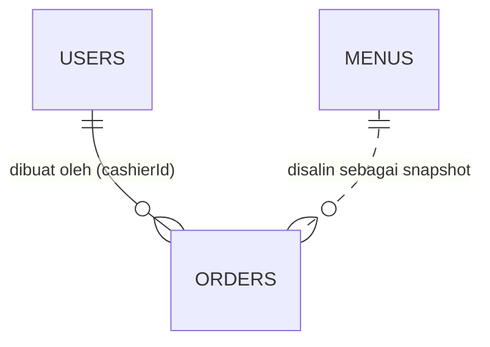

# Database Design – POS Application

**Database:** Cloud Firestore (Firebase)  
**Autentikasi:** Firebase Authentication (email/password)  
**Status:** Rancangan awal MVP

> Firestore adalah database dokumen (koleksi → dokumen → field), bukan tabel relasional. Tidak ada foreign key, join, atau constraint di sisi database, sehingga validasi dilakukan di aplikasi dan sebagian di Security Rules. Jika tim memilih Realtime Database, struktur di bawah dapat dipetakan menjadi pohon JSON dengan jalur yang sama, tetapi aturan keamanannya memakai sintaks yang berbeda.

---

## 1. Prinsip Desain

1. Setiap koleksi menyimpan satu jenis data: `users`, `menus`, `orders`.
2. Nominal uang disimpan sebagai bilangan bulat rupiah (`number` bertipe integer), bukan desimal. Format tampilan (`Rp 15.000`) dibuat di aplikasi dengan paket `intl`.
3. Waktu disimpan sebagai `Timestamp` Firestore (diisi dengan `FieldValue.serverTimestamp()` agar tidak bergantung jam perangkat).
4. Item pesanan disimpan sebagai snapshot (nama, harga, kuantitas) di dalam dokumen pesanan, sehingga perubahan atau penghapusan menu tidak mengubah riwayat.
5. Role disimpan di dokumen `users/{uid}`, dengan `uid` sama dengan UID Firebase Authentication.
6. Data yang selalu dibaca bersama disimpan dalam satu dokumen (denormalisasi) untuk mengurangi jumlah pembacaan.

---

## 2. Daftar Koleksi

| Koleksi | Fungsi | Dokumen ID |
|---|---|---|
| `users` | Profil dan role akun Admin/Kasir | UID dari Firebase Authentication |
| `menus` | Daftar menu/produk | ID otomatis Firestore |
| `orders` | Pesanan, item, dan status pembayaran | ID otomatis Firestore |

Tidak ada koleksi khusus untuk token atau webhook karena tidak ada backend sendiri.

---

## 3. Definisi Koleksi

### 3.1 `users/{uid}`

| Field | Tipe | Keterangan |
|---|---|---|
| `name` | string | Nama pengguna, wajib |
| `email` | string | Email login |
| `role` | string | `admin` atau `kasir`, wajib |
| `isActive` | boolean | Akun nonaktif tidak boleh masuk, default `true` |
| `createdAt` | timestamp | |

Catatan:
- Akun dibuat di Firebase Console (Authentication → Add user), lalu dokumen `users/{uid}` dibuat manual dengan UID yang sama. Pembuatan akun dari dalam aplikasi tidak termasuk MVP.
- Password tidak disimpan di Firestore; Firebase Authentication yang mengelolanya.

Contoh:

```json
{
  "name": "Admin Toko",
  "email": "admin@contoh.com",
  "role": "admin",
  "isActive": true
}
```

### 3.2 `menus/{menuId}`

| Field | Tipe | Keterangan |
|---|---|---|
| `name` | string | Nama menu, wajib |
| `price` | number (integer) | Harga rupiah, wajib, > 0 |
| `category` | string | Opsional, untuk filter |
| `description` | string | Opsional |
| `imageUrl` | string | Opsional (fitur tambahan) |
| `createdAt` | timestamp | |
| `updatedAt` | timestamp | Diperbarui setiap perubahan |

Catatan:
- Penghapusan menu bersifat permanen. Histori transaksi tetap aman karena item pesanan menyimpan snapshot.
- Kategori disimpan sebagai teks biasa pada MVP. Jika kelak dibutuhkan pengelolaan kategori, buat koleksi `categories`.

Contoh:

```json
{
  "name": "Es Teh Manis",
  "price": 5000,
  "category": "Minuman"
}
```

### 3.3 `orders/{orderId}`

| Field | Tipe | Keterangan |
|---|---|---|
| `invoiceNumber` | string | Unik, contoh `INV-20261120-A7K2` |
| `cashierId` | string | UID Kasir pembuat pesanan |
| `cashierName` | string | Snapshot nama Kasir |
| `items` | array of map | Lihat tabel item di bawah |
| `total` | number (integer) | Jumlah seluruh subtotal item |
| `status` | string | `pending_payment`, `paid`, `cancelled`, `expired` |
| `payment` | map | Lihat tabel pembayaran di bawah; `null` sebelum tagihan dibuat |
| `createdAt` | timestamp | |
| `updatedAt` | timestamp | |
| `paidAt` | timestamp | Diisi saat status menjadi `paid` |

Setiap elemen `items`:

| Field | Tipe | Keterangan |
|---|---|---|
| `menuId` | string | ID menu saat checkout (hanya rujukan, boleh sudah tidak ada) |
| `name` | string | Snapshot nama |
| `price` | number (integer) | Snapshot harga satuan |
| `quantity` | number (integer) | Bilangan bulat > 0 |
| `subtotal` | number (integer) | `price × quantity` |

Isi `payment`:

| Field | Tipe | Keterangan |
|---|---|---|
| `provider` | string | `miomipay` atau `mock` |
| `reference` | string | Referensi/ID transaksi dari MiomiPay |
| `method` | string | Metode pembayaran, sesuai respons provider |
| `amount` | number (integer) | Harus sama dengan `total` |
| `status` | string | `pending`, `paid`, `failed`, `expired`, `cancelled` |
| `paymentUrl` | string | URL atau instruksi pembayaran dari provider, jika ada |
| `expiresAt` | timestamp | Jika disediakan provider |

Catatan:
- Pada MVP, satu pesanan memiliki satu tagihan aktif di dalam field `payment`. Jika perlu riwayat percobaan pembayaran, pindahkan ke subkoleksi `orders/{orderId}/payments`.
- Jangan menyimpan kunci API atau data autentikasi provider di dokumen mana pun.
- Nama dan format field `payment` yang berasal dari MiomiPay harus disesuaikan dengan dokumentasi resmi. Tabel di atas adalah rancangan internal.

Contoh:

```json
{
  "invoiceNumber": "INV-20261120-A7K2",
  "cashierId": "uidKasir123",
  "cashierName": "Kasir 1",
  "items": [
    { "menuId": "m1", "name": "Es Teh Manis", "price": 5000, "quantity": 2, "subtotal": 10000 }
  ],
  "total": 10000,
  "status": "pending_payment",
  "payment": { "provider": "mock", "reference": "TRX-001", "amount": 10000, "status": "pending" }
}
```

---

## 4. Relasi Antar Data



Keterangan:
- `users` ke `orders`: satu Kasir dapat membuat banyak pesanan (rujukan lewat `cashierId`, tanpa foreign key).
- `menus` ke `orders`: hanya disalin sebagai snapshot saat checkout; tidak ada ketergantungan yang harus dijaga.

---

## 5. Alur Penyimpanan Checkout

1. Kasir menekan Checkout; tombol dinonaktifkan agar tidak terkirim dua kali.
2. Aplikasi membaca ulang dokumen menu untuk setiap item di keranjang.
3. Jika ada menu yang sudah dihapus, checkout dibatalkan dan Kasir diberi tahu.
4. Aplikasi menghitung subtotal tiap item dan total dari harga yang baru dibaca.
5. Aplikasi membuat `invoiceNumber`.
6. Aplikasi menyimpan dokumen `orders` dengan status `pending_payment` dalam satu operasi tulis.
7. Aplikasi membuat tagihan ke MiomiPay lalu menyimpan hasilnya ke field `payment`.
8. Jika pembuatan tagihan gagal, pesanan tetap tersimpan dan Kasir dapat mencoba lagi atau membatalkan.
9. Setelah status pembayaran terverifikasi dari MiomiPay, aplikasi memperbarui `payment.status`, `status`, dan `paidAt`.

Catatan keterbatasan: `invoiceNumber` dibuat di sisi aplikasi dari tanggal dan kode acak, sehingga keunikan tidak dijamin oleh database seperti constraint UNIQUE. Untuk skala tugas ini kemungkinan bentrokan sangat kecil. Alternatif yang lebih kuat adalah memakai ID dokumen Firestore sebagai bagian dari nomor invoice.

---

## 6. Status Data

### Payment (`payment.status`)

| Status | Arti |
|---|---|
| `pending` | Menunggu pembayaran |
| `paid` | Dinyatakan berhasil oleh MiomiPay |
| `failed` | Gagal |
| `expired` | Kedaluwarsa |
| `cancelled` | Dibatalkan |

### Order (`status`)

| Status | Arti |
|---|---|
| `pending_payment` | Menunggu pembayaran |
| `paid` | Sudah dibayar |
| `cancelled` | Dibatalkan |
| `expired` | Kedaluwarsa |

Status final dipetakan dari respons resmi MiomiPay dan aturan bisnis yang disetujui tim. Status `paid` tidak diubah kembali.

---

## 7. Firestore Security Rules

Rules berikut adalah rancangan awal dan harus diuji (Rules Playground atau Emulator) sebelum dipakai. Jangan menggunakan mode test terbuka (`allow read, write: if true`) pada pengumpulan tugas.

```javascript
rules_version = '2';
service cloud.firestore {
  match /databases/{database}/documents {

    function signedIn() {
      return request.auth != null;
    }
    function me() {
      return get(/databases/$(database)/documents/users/$(request.auth.uid)).data;
    }
    function isAdmin() {
      return signedIn() && me().role == 'admin' && me().isActive == true;
    }
    function isKasir() {
      return signedIn() && me().role == 'kasir' && me().isActive == true;
    }

    // Pengguna hanya boleh membaca profilnya sendiri; Admin boleh membaca semua.
    // Penulisan dilakukan lewat Firebase Console.
    match /users/{uid} {
      allow read: if signedIn() && (request.auth.uid == uid || isAdmin());
      allow write: if false;
    }

    // Admin dan Kasir boleh membaca menu; hanya Admin yang boleh mengubah.
    match /menus/{menuId} {
      allow read: if isAdmin() || isKasir();
      allow create, update: if isAdmin()
        && request.resource.data.name is string
        && request.resource.data.name.size() > 0
        && request.resource.data.price is int
        && request.resource.data.price > 0;
      allow delete: if isAdmin();
    }

    // Kasir membuat dan membaca pesanannya sendiri; Admin membaca semua.
    match /orders/{orderId} {
      allow read: if isAdmin()
        || (isKasir() && resource.data.cashierId == request.auth.uid);

      allow create: if isKasir()
        && request.resource.data.cashierId == request.auth.uid
        && request.resource.data.status == 'pending_payment'
        && request.resource.data.total is int
        && request.resource.data.total > 0;

      // Kasir hanya boleh memperbarui pesanannya sendiri dan tidak boleh
      // mengubah isi pesanan (item, total, pemilik).
      allow update: if isKasir()
        && resource.data.cashierId == request.auth.uid
        && request.resource.data.cashierId == resource.data.cashierId
        && request.resource.data.items == resource.data.items
        && request.resource.data.total == resource.data.total
        && resource.data.status != 'paid';

      allow delete: if false;
    }
  }
}
```

Keterbatasan Rules ini (perlu dicatat dalam laporan):
- Rules tidak dapat memverifikasi bahwa MiomiPay benar-benar menyatakan pembayaran berhasil. Kasir yang memodifikasi aplikasi masih dapat menulis `status: 'paid'` pada pesanannya sendiri.
- Rules tidak menghitung ulang `total` dari harga menu.
- Setiap evaluasi Rules yang memakai `get()` ke `users/{uid}` dihitung sebagai satu pembacaan dokumen.

Penyelesaian yang lebih kuat adalah memindahkan pembuatan tagihan dan penetapan status `paid` ke Cloud Functions, di mana hanya server yang boleh menulis status pembayaran.

---

## 8. Index dan Kueri

- Daftar menu: `menus` diurutkan berdasarkan `name` (kueri satu field, tidak perlu index tambahan).
- Riwayat Kasir (opsional): `orders` dengan `where cashierId == uid` dan `orderBy createdAt desc`. Kueri gabungan ini membutuhkan composite index; Firestore menampilkan tautan pembuatan index pada pesan error saat pertama kali dijalankan.
- Riwayat Admin (opsional): `orders` diurutkan `createdAt desc` dengan `limit`.
- Pencarian teks pada menu dilakukan di aplikasi atas data yang sudah dimuat, karena Firestore tidak mendukung pencarian teks parsial.

---

## 9. Tanggung Jawab Implementasi

| Bagian | Penanggung jawab |
|---|---|
| Setup Firebase, `users`, Security Rules | Anggota 1 |
| Koleksi `menus` dan service CRUD | Anggota 2 |
| Koleksi `orders` dan service pesanan | Anggota 1 |
| Field `payment` dan integrasi MiomiPay | Anggota 2 |
| Konsumsi data dan state UI | Anggota 3 |

Perubahan struktur field harus diberitahukan ke seluruh anggota, karena model Dart (`fromMap`/`toMap`) harus mengikuti struktur ini.