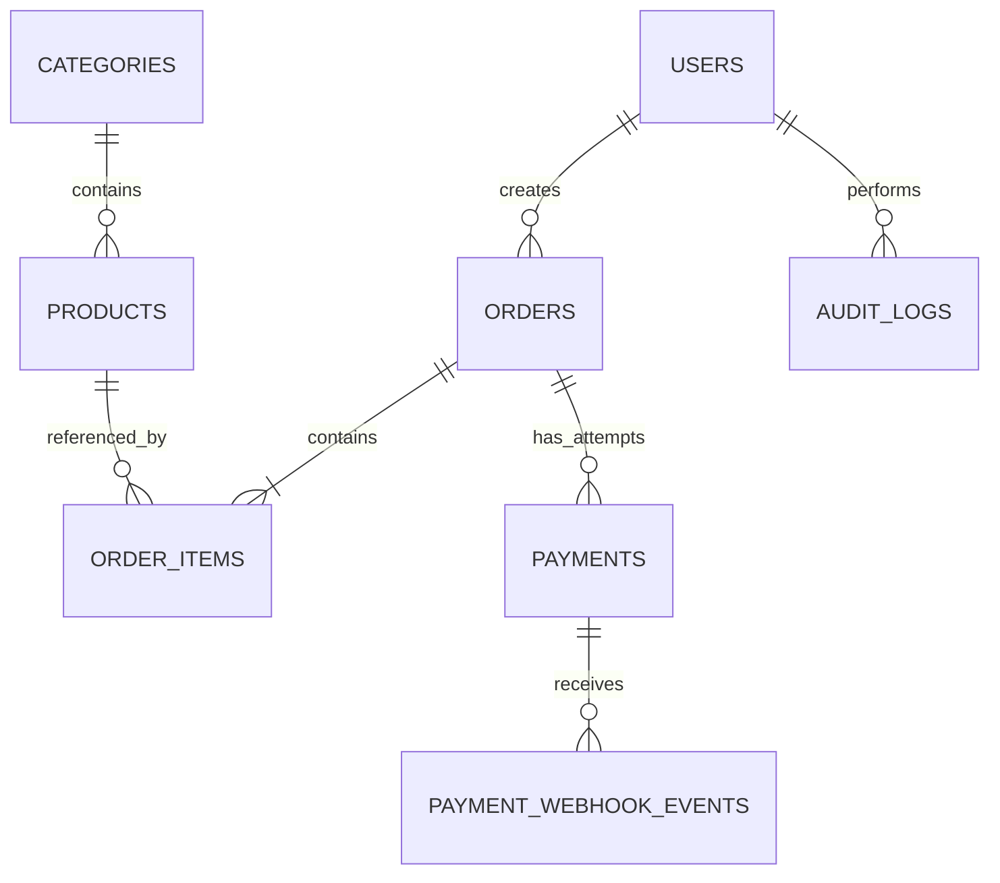

# Database Design – POS Application

**Database:** PostgreSQL  
**Schema:** `public`  
**Status:** Rancangan awal MVP

> Nama tabel dan kolom di bawah adalah rancangan database internal aplikasi POS. Sesuaikan tipe data, constraint, dan migration dengan versi Laravel/PostgreSQL yang dipakai.

---

## 1. Prinsip Desain

1. Gunakan primary key `BIGINT` identity atau strategi ID yang disepakati.
2. Gunakan foreign key untuk menjaga integritas relasi.
3. Gunakan `NUMERIC(14,2)` untuk nominal uang, bukan floating point.
4. Gunakan timestamp untuk waktu pencatatan.
5. Simpan snapshot nama produk, SKU, dan harga pada detail transaksi.
6. Gunakan soft delete/nonaktif untuk produk dan kategori sesuai kebutuhan.
7. Simpan event webhook dengan identitas unik untuk idempotensi.
8. Semua waktu disimpan secara konsisten; tetapkan timezone aplikasi, misalnya `Asia/Jakarta`.

---

## 2. Daftar Tabel

| Tabel | Fungsi |
|---|---|
| `users` | Akun Admin dan Kasir |
| `categories` | Kategori produk |
| `products` | Data produk |
| `orders` | Header transaksi |
| `order_items` | Rincian item transaksi |
| `payments` | Percobaan dan status pembayaran |
| `payment_webhook_events` | Log notifikasi payment provider |
| `personal_access_tokens` | Token Laravel Sanctum |
| `audit_logs` | Catatan aktivitas penting (opsional tetapi direkomendasikan) |

---

## 3. Definisi Tabel

### 3.1 `users`

| Kolom | Tipe | Constraint/Keterangan |
|---|---|---|
| `id` | BIGINT | PK |
| `name` | VARCHAR(150) | NOT NULL |
| `email` | VARCHAR(255) | NOT NULL, UNIQUE |
| `password` | VARCHAR(255) | NOT NULL, password hash |
| `role` | VARCHAR(20) | NOT NULL, `admin`/`cashier` |
| `is_active` | BOOLEAN | NOT NULL, default true |
| `email_verified_at` | TIMESTAMP NULL | Opsional |
| `created_at` | TIMESTAMP | |
| `updated_at` | TIMESTAMP | |

Index:
- Unique index pada `email`.
- Index pada `role` jika sering dipakai untuk filter.

### 3.2 `categories`

| Kolom | Tipe | Constraint/Keterangan |
|---|---|---|
| `id` | BIGINT | PK |
| `name` | VARCHAR(100) | NOT NULL |
| `description` | TEXT NULL | Opsional |
| `created_at` | TIMESTAMP | |
| `updated_at` | TIMESTAMP | |
| `deleted_at` | TIMESTAMP NULL | Jika soft delete dipakai |

Nama kategori sebaiknya unik sesuai aturan bisnis.

### 3.3 `products`

| Kolom | Tipe | Constraint/Keterangan |
|---|---|---|
| `id` | BIGINT | PK |
| `category_id` | BIGINT | FK ke categories |
| `sku` | VARCHAR(60) | NOT NULL, UNIQUE |
| `name` | VARCHAR(180) | NOT NULL |
| `description` | TEXT NULL | |
| `price` | NUMERIC(14,2) | NOT NULL, CHECK > 0 |
| `image_path` | TEXT NULL | Path/URL gambar |
| `is_active` | BOOLEAN | NOT NULL, default true |
| `created_at` | TIMESTAMP | |
| `updated_at` | TIMESTAMP | |
| `deleted_at` | TIMESTAMP NULL | Soft delete |

Relasi:
- Satu kategori memiliki banyak produk.
- Satu produk dimiliki satu kategori (untuk rancangan MVP).

Index:
- Unique `sku`.
- Index `category_id`.
- Index `is_active`.
- Pertimbangkan pencarian nama/SKU sesuai kebutuhan.

### 3.4 `orders`

| Kolom | Tipe | Constraint/Keterangan |
|---|---|---|
| `id` | BIGINT | PK |
| `invoice_number` | VARCHAR(60) | NOT NULL, UNIQUE |
| `cashier_id` | BIGINT | FK ke users |
| `subtotal` | NUMERIC(14,2) | NOT NULL |
| `discount_amount` | NUMERIC(14,2) | NOT NULL, default 0 |
| `tax_amount` | NUMERIC(14,2) | NOT NULL, default 0 |
| `total_amount` | NUMERIC(14,2) | NOT NULL |
| `status` | VARCHAR(30) | NOT NULL |
| `notes` | TEXT NULL | Opsional |
| `paid_at` | TIMESTAMP NULL | |
| `created_at` | TIMESTAMP | |
| `updated_at` | TIMESTAMP | |

Relasi:
- Satu Kasir memiliki banyak order.
- Satu order memiliki banyak order items.
- Satu order dapat memiliki beberapa payment attempts.

Constraint:
- `invoice_number` unik.
- Nominal tidak boleh negatif.
- `cashier_id` wajib merujuk user role Kasir (validasi role dilakukan aplikasi atau constraint tambahan jika dirancang).

### 3.5 `order_items`

| Kolom | Tipe | Constraint/Keterangan |
|---|---|---|
| `id` | BIGINT | PK |
| `order_id` | BIGINT | FK ke orders |
| `product_id` | BIGINT NULL | FK ke products; nullable untuk mempertahankan histori jika produk dihapus |
| `product_name` | VARCHAR(180) | Snapshot nama |
| `sku` | VARCHAR(60) NULL | Snapshot SKU |
| `quantity` | INTEGER | NOT NULL, CHECK > 0 |
| `unit_price` | NUMERIC(14,2) | NOT NULL |
| `subtotal` | NUMERIC(14,2) | NOT NULL |
| `created_at` | TIMESTAMP | |
| `updated_at` | TIMESTAMP | |

Snapshot memastikan transaksi lama tidak berubah ketika nama, SKU, atau harga produk diperbarui.

### 3.6 `payments`

| Kolom | Tipe | Constraint/Keterangan |
|---|---|---|
| `id` | BIGINT | PK |
| `order_id` | BIGINT | FK ke orders |
| `provider` | VARCHAR(40) | Misalnya `miomipay` |
| `payment_reference` | VARCHAR(150) NULL | Referensi provider |
| `payment_method` | VARCHAR(60) NULL | Metode provider |
| `amount` | NUMERIC(14,2) | NOT NULL |
| `currency` | CHAR(3) | Misalnya `IDR` |
| `status` | VARCHAR(20) | NOT NULL |
| `payment_url` | TEXT NULL | URL/instruksi dari provider |
| `provider_payload` | JSONB NULL | Simpan hanya data yang diperlukan dan aman |
| `expires_at` | TIMESTAMP NULL | |
| `paid_at` | TIMESTAMP NULL | |
| `created_at` | TIMESTAMP | |
| `updated_at` | TIMESTAMP | |

Catatan:
- Satu order dapat mempunyai lebih dari satu payment attempt jika percobaan sebelumnya gagal/kedaluwarsa.
- `payment_reference` sebaiknya unik per provider jika provider menjaminnya.
- Jangan menyimpan secret atau data autentikasi provider di tabel ini.

### 3.7 `payment_webhook_events`

| Kolom | Tipe | Constraint/Keterangan |
|---|---|---|
| `id` | BIGINT | PK |
| `provider` | VARCHAR(40) | Nama provider |
| `provider_event_id` | VARCHAR(180) | ID event provider |
| `payment_id` | BIGINT NULL | FK ke payments |
| `event_type` | VARCHAR(100) NULL | Jenis event |
| `payload` | JSONB | Payload yang sudah disaring |
| `signature_valid` | BOOLEAN | Hasil validasi |
| `processed_at` | TIMESTAMP NULL | Waktu diproses |
| `processing_status` | VARCHAR(30) | received/processed/failed |
| `created_at` | TIMESTAMP | |

Constraint:
- Unique gabungan (`provider`, `provider_event_id`) jika provider menyediakan event ID stabil.
- Jangan memproses event yang sama lebih dari satu kali.

### 3.8 `personal_access_tokens`

Tabel ini dibuat/dikelola oleh Laravel Sanctum melalui migration paket. Jangan membuat struktur sendiri tanpa memeriksa migration resmi versi yang digunakan.

### 3.9 `audit_logs` (Opsional)

| Kolom | Tipe | Constraint/Keterangan |
|---|---|---|
| `id` | BIGINT | PK |
| `user_id` | BIGINT NULL | FK ke users |
| `action` | VARCHAR(100) | Jenis aktivitas |
| `entity_type` | VARCHAR(100) | Model/entitas |
| `entity_id` | BIGINT NULL | ID entitas |
| `metadata` | JSONB NULL | Perubahan yang aman dicatat |
| `created_at` | TIMESTAMP | |

Hindari mencatat password, token, secret, atau informasi sensitif ke audit log.

---

## 4. Relasi Antar Tabel

Keterangan:
- `users` ke `orders`: one-to-many.
- `categories` ke `products`: one-to-many.
- `orders` ke `order_items`: one-to-many.
- `products` ke `order_items`: one-to-many.
- `orders` ke `payments`: one-to-many.
- `payments` ke `payment_webhook_events`: one-to-many.

---

## 5. Alur Penyimpanan Checkout

1. Laravel menerima `product_id` dan `quantity` dari Flutter.
2. Laravel memvalidasi role Kasir dan status produk.
3. Laravel membaca harga aktual dari tabel `products`.
4. Laravel menghitung subtotal setiap item dan total order.
5. Laravel membuat `orders` dan `order_items` dalam satu database transaction.
6. Laravel membuat payment attempt dan meminta tagihan ke provider.
7. Jika provider gagal, order tetap tercatat dengan status yang sesuai dan dapat ditangani melalui retry/expiry.
8. Setelah webhook/inquiry terverifikasi, backend memperbarui payment dan order.

Jangan menyimpan order hanya berdasarkan total yang dikirim Flutter.

---

## 6. Status Data

### Payment

| Status | Arti |
|---|---|
| `pending` | Menunggu pembayaran |
| `paid` | Terverifikasi berhasil |
| `failed` | Gagal |
| `expired` | Kedaluwarsa |
| `cancelled` | Dibatalkan |

### Order

| Status | Arti |
|---|---|
| `pending_payment` | Menunggu pembayaran |
| `paid` | Sudah dibayar |
| `cancelled` | Dibatalkan |
| `expired` | Kedaluwarsa |

Status final harus dipetakan dari respons resmi MiomiPay dan aturan bisnis yang disetujui tim.

---

## 7. Aturan Integritas dan Index

- Foreign key untuk semua relasi.
- Unique constraint untuk `users.email`, `products.sku`, `orders.invoice_number`.
- Unique constraint event webhook berdasarkan provider dan event ID.
- Check constraint kuantitas > 0.
- Check constraint harga dan nominal >= 0; harga produk wajib > 0.
- Index `orders.cashier_id`, `orders.created_at`, `orders.status`.
- Index `order_items.order_id`, `payments.order_id`, `payments.payment_reference`.
- Gunakan transaksi database untuk operasi checkout dan pemrosesan webhook.

---

## 8. Tanggung Jawab Implementasi

| Bagian | Penanggung jawab |
|---|---|
| `users`, Sanctum, role | Anggota 1 |
| `categories`, `products` | Anggota 1 |
| `orders`, `order_items` | Anggota 2 |
| `payments`, webhook events | Anggota 2 |
| Konsumsi data dan state UI | Anggota 3 |

Migration harus dikoordinasikan agar seluruh migration dapat dijalankan berurutan pada satu database.
